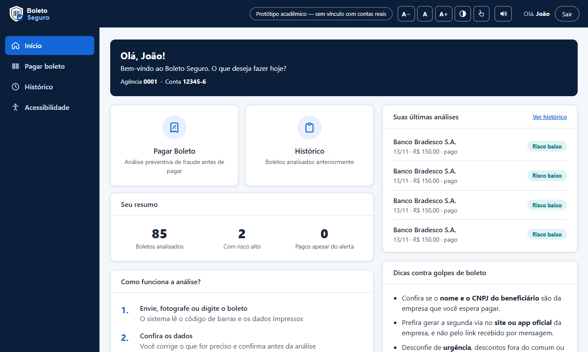
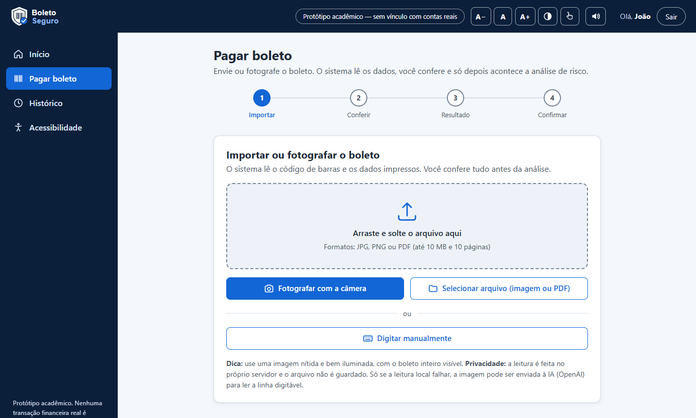
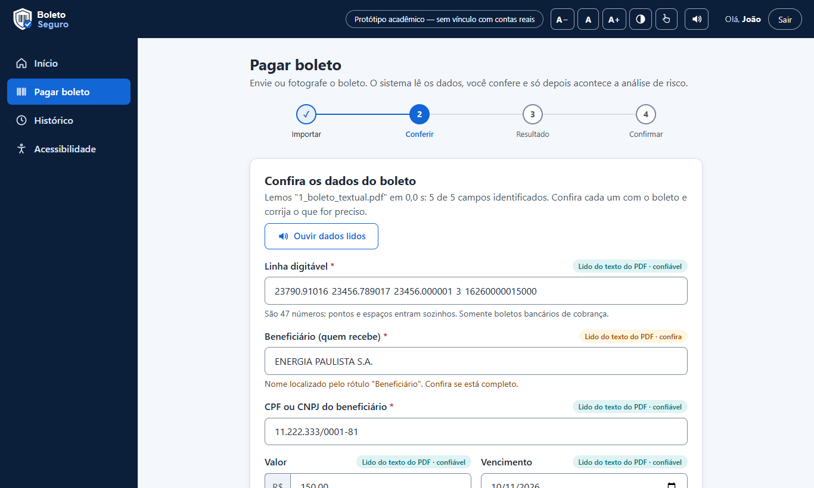
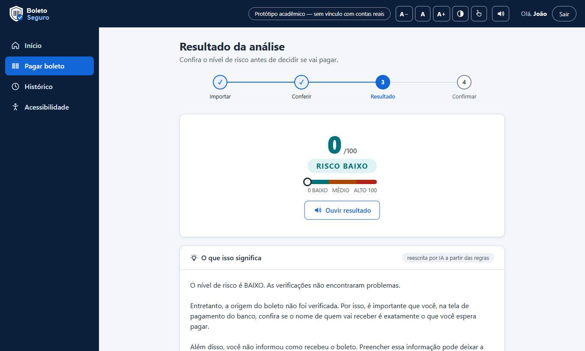
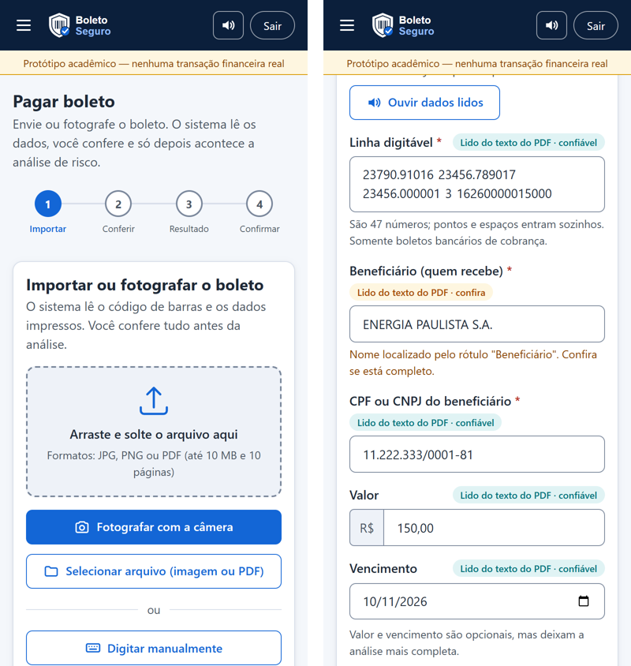
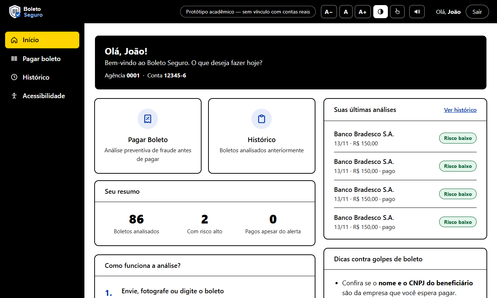

# Boleto Seguro

**Analisa o risco de golpe de um boleto bancário _antes_ do pagamento** — a pessoa fotografa ou envia o boleto, confere os
dados lidos e recebe uma nota de risco de 0 a 100 com explicação em linguagem simples.

> 🎓 **Protótipo acadêmico** (atividade A3 — Ciência da Computação, Universidade Anhembi Morumbi).
> Nenhuma transação financeira é realizada; os usuários são fictícios. Não use senhas bancárias reais.



## O que ele faz

- **Importa o boleto** por foto (câmera do celular), imagem ou PDF — ou digitação. Lê a linha digitável pelo texto do PDF,
  pelo código de barras ou por OCR, e também os campos impressos: beneficiário, CPF/CNPJ, valor e vencimento.
- **Conferência humana obrigatória:** cada campo mostra de onde veio ("Lido do código de barras · confiável",
  "Lido por OCR · confira", "Não identificado") e nada é analisado sem a pessoa confirmar.
- **Análise de risco por regras** (sempre igual para os mesmos dados), com 8 verificações: valor e vencimento contra o
  código de barras, prazo, origem, validade do CPF/CNPJ, **cadastro público do CNPJ** (BrasilAPI / Receita Federal),
  **instituição** pelo código do boleto e **denúncias** de outros usuários.
- **Explicação em linguagem simples**, que pode ser reescrita por IA (OpenAI) de forma mais natural — sem nunca enviar nome
  ou CPF/CNPJ, e com o texto das regras sempre disponível.
- **Denunciar boleto:** quem analisar um boleto com o mesmo CPF/CNPJ vê quantas pessoas denunciaram (nunca quem).
- **Acessibilidade** (objetivo WCAG 2.2 AA): teclado, leitor de tela, alto contraste, texto até 150%,
  "Ouvir esta página" e "Ler ao apontar".
- Histórico com filtros, confirmação **simulada** e dois temas visuais (identidade própria e tema acadêmico).

| Importar | Conferir | Resultado |
|---|---|---|
|  |  |  |

| Celular | Alto contraste e texto ampliado |
|---|---|
|  |  |

## O que ele **não** faz (e por quê)

- **Não confirma quem recebe o dinheiro.** Isso só a base de boletos registrados (CIP / Nova Plataforma de Cobrança)
  confirmaria, e o protótipo não a acessa. O CNPJ na Receita mostra se a empresa existe e está ativa — não que o boleto é dela.
- **Não analisa contas de consumo** (luz, água, gás, telefone, tributos — boletos de arrecadação, que começam com 8 e têm
  48 números). Elas são reconhecidas (digitadas, por foto ou PDF) e recusadas com uma explicação. Motivo: seguem outro
  padrão Febraban, sem banco nem (em geral) vencimento no código, então quase nenhuma verificação se aplica. Detalhes e
  como seria a evolução em [`ESTADO_DO_PROJETO.md`](ESTADO_DO_PROJETO.md#10-limitações-conhecidas-decisões-conscientes).
- **Não paga nada:** a confirmação é simulada.

## Tecnologias

Java 21 · Spring Boot 4 (Web MVC, Security, Data JPA, Validation) · PostgreSQL + Flyway · JWT ·
PDFBox · ZXing · Tesseract OCR · BrasilAPI · OpenAI (opcional) · HTML + Bootstrap 5 + JavaScript ·
JUnit 5 + H2 · Docker · Render

## Como rodar

```powershell
# Pré-requisitos: Java 21, PostgreSQL; Tesseract com idioma Português (opcional)
copy config\application.properties.example config\application.properties   # preencha senha do banco e chave do login
.\mvnw.cmd test                # testes automatizados
.\mvnw.cmd spring-boot:run     # http://localhost:8080
```
Usuário de demonstração: agência `0001`, conta `12345-6`, senha `senha123`.

Detalhes: [`COMO_EXECUTAR.md`](COMO_EXECUTAR.md) · Nuvem: [`DEPLOY_RENDER.md`](DEPLOY_RENDER.md) ·
Para testar: [`docs/testes/`](docs/testes/)

## Documentação

| Documento | Conteúdo |
|---|---|
| [`docs/ARQUITETURA.md`](docs/ARQUITETURA.md) | Componentes, fluxos de importação e análise, implantação, decisões, segurança |
| [`docs/MODELO_DE_DADOS.md`](docs/MODELO_DE_DADOS.md) | MER/DER do banco real e dicionário de dados |
| [`docs/API.md`](docs/API.md) | Rotas da API REST com exemplos reais |
| [`docs/diagramas/`](docs/diagramas/) | Diagramas em PNG (arquitetura, fluxos, implantação, MER e DER) para slides |
| [`docs/scripts/LIMPAR_DADOS.md`](docs/scripts/LIMPAR_DADOS.md) | Limpar os dados de teste do banco antes de apresentar |
| [`docs/testes/ROTEIRO_DE_TESTES.md`](docs/testes/ROTEIRO_DE_TESTES.md) | Roteiro de testes manuais |
| [`ESTADO_DO_PROJETO.md`](ESTADO_DO_PROJETO.md) | O que está implementado, limitações e próximos passos |
| `/acessibilidade.html` (no sistema) | Recursos e declaração de acessibilidade |

## Privacidade e segurança, em resumo

O arquivo do boleto não é guardado. Só o CNPJ vai para a BrasilAPI; a IA de explicação não recebe nome nem CPF/CNPJ.
Nenhum segredo está no repositório (variáveis de ambiente / `config/application.properties` local). Cada usuário só
acessa os próprios boletos.

## Equipe

Bruno Henrique · Heitor Cabral de Brito · Miguel Antonio dos Santos Silva

Orientação: Profa. Cassilene Assis

Projeto desenvolvido para a Universidade Anhembi Morumbi, em atividade acadêmica com o Bradesco.
Os logotipos do Bradesco (pasta `marca-academica/`, tema acadêmico) são usados com autorização restrita a esta atividade
acadêmica, só para a apresentação; este é um trabalho acadêmico, sem vínculo oficial com o banco.
