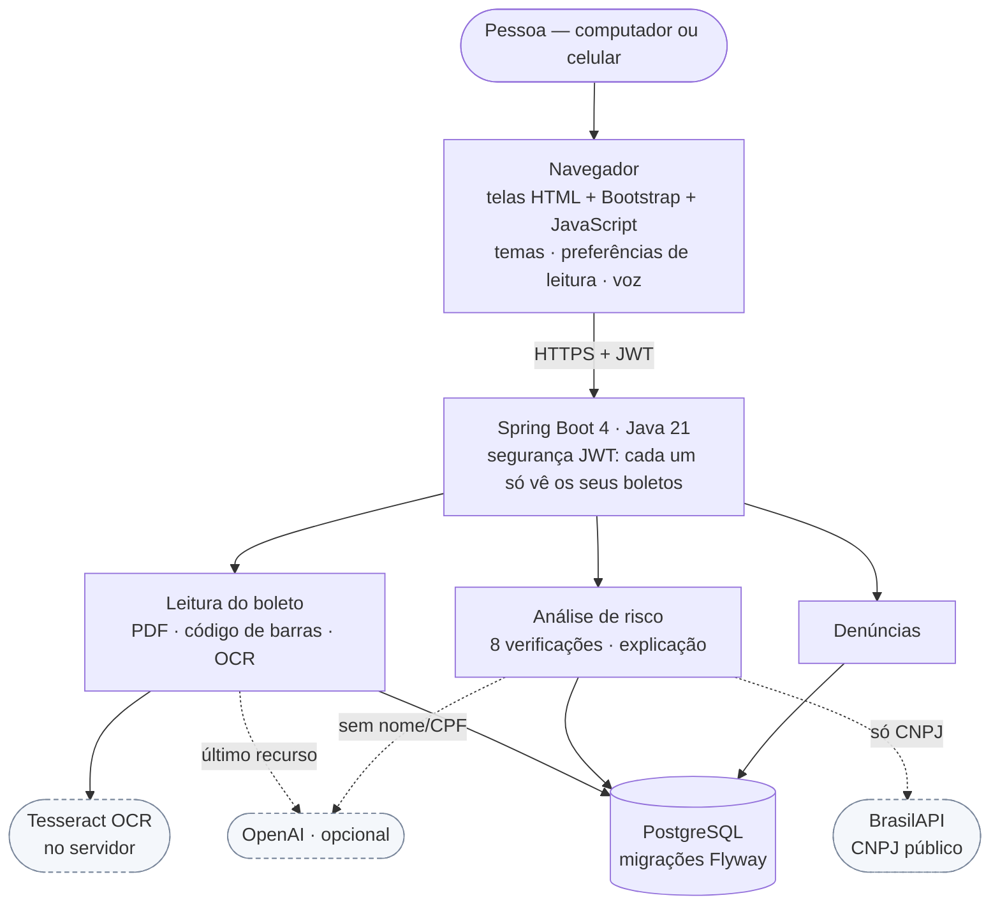
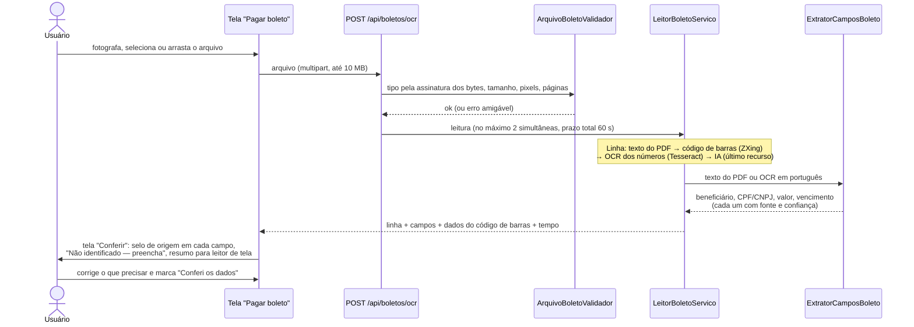
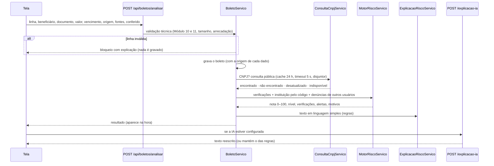
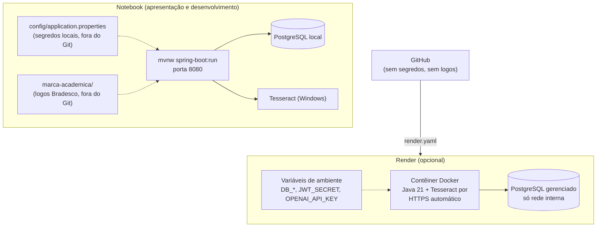

# Arquitetura do Boleto Seguro

> Protótipo acadêmico (A3 — Universidade Anhembi Morumbi). Descreve o código **como está** no Checkpoint 3.

## Visão geral

Uma única aplicação **Spring Boot** serve as telas (HTML/CSS/JavaScript estáticos) e a API REST. O banco é **PostgreSQL**,
com as tabelas criadas por migrações **Flyway**. A leitura de boletos roda no próprio servidor (PDFBox, ZXing e Tesseract).
Os dois serviços externos são opcionais e nunca bloqueiam a análise: **BrasilAPI** (CNPJ) e **OpenAI** (leitura difícil e
explicação reescrita). O Bootstrap é servido pelo próprio app, então as telas funcionam sem internet.

## Fluxo 1 — Importar e conferir o boleto

Regra importante: valor e vencimento **nunca** são tirados da linha digitável para preencher os campos — são os impressos
no papel (ou digitados) e, por isso, podem ser comparados de forma independente com os gravados no código de barras.

## Fluxo 2 — Análise de risco

### Verificações do motor de risco

| # | Verificação | Pontos |
|---|---|---|
| 1 | Valor informado ≠ valor gravado no código de barras | +40 |
| 2 | Vencimento informado ≠ vencimento gravado no código | +30 |
| 3 | Vencido há mais de 60 dias (pelo código) | +20 · pela data só informada: atenção, 0 |
| 4 | Origem WhatsApp | +15 |
| 5 | CPF/CNPJ inexistente · empresa em CPF · nome incompleto | +50 · +30 · +20 |
| 6 | Cadastro do CNPJ: não ativo · não encontrado · nome diferente | +30 · +20 · +20 (fonte fora do ar = não verificado, 0) |
| 7 | Instituição do código diferente da esperada (se informada) | +15 |
| 8 | Denúncias de outros usuários: 1 · 2 ou mais | atenção, 0 · +25 |

Classificação: **0–30 baixo · 31–70 médio · 71–100 alto** (nota limitada a 100). Cada verificação termina como
**Passou**, **Falhou**, **Atenção** ou **Não verificado**.

## Implantação

## Decisões de projeto

| Decisão | Motivo |
|---|---|
| Análise determinística (regras), IA só como apoio | Mesmo resultado para os mesmos dados; funciona sem internet e sem créditos; a IA não decide nada |
| Conferência humana obrigatória antes da análise | OCR e IA erram; nenhum dado lido automaticamente é aceito sem o "Conferi os dados" |
| Dados públicos (CNPJ) mostrados como indício, não prova | A Receita mostra se a empresa existe, não quem recebe o dinheiro do boleto (isso só a CIP/NPC confirmaria) |
| Denúncia com 1 voto = só atenção | Uma pessoa sozinha não pode prejudicar uma empresa com denúncias falsas |
| Dois temas por variáveis CSS, um só código | Identidade própria pública; tema acadêmico Bradesco só com os logotipos locais |
| Migrações versionadas (Flyway) + `ddl-auto=validate` | O banco da nuvem nasce igual ao local; mudança de tabela só por migração revisável |

## Segurança e privacidade

- **Autenticação:** JWT sem estado (24 h), senha com BCrypt; a chave (`JWT_SECRET`) é conferida ao iniciar.
- **Autorização:** cada usuário só vê e altera os próprios boletos; confirmar, denunciar e pedir explicação de boleto alheio
  devolve 403 (testado em `PersistenciaIntegracaoTest` e `DenunciaIntegracaoTest`).
- **Upload:** tipo pela assinatura do arquivo, 10 MB, 40 megapixels lidos só do cabeçalho, 10 páginas, render de PDF limitado,
  leituras simultâneas limitadas (503 "tente de novo"), prazo por leitura, timeout real do Tesseract, temporários apagados.
  O arquivo não é guardado.
- **Dados externos:** só CNPJ vai para a BrasilAPI; a IA de explicação recebe só nível, nota e nome/estado das verificações.
- **Segredos:** nenhum no Git — variáveis de ambiente na nuvem, `config/application.properties` local.
- **Logs:** sem dados dos boletos (tipo do arquivo, quantidade de campos lidos e tempo); nunca a chave da IA.
- **Erros:** respostas sem pilha nem mensagens internas.

## Acessibilidade (WCAG 2.2 AA como objetivo verificado)

HTML semântico, rótulos ligados aos campos, `aria-invalid`, anúncios com `aria-live`, foco visível, "Pular para o conteúdo",
navegação completa por teclado, contraste medido por teste automático (dois temas + alto contraste), preferências de
texto (até 150%) e alto contraste, "Ouvir esta página" e "Ler ao apontar" (Web Speech API, sempre sob demanda).
Detalhes e declaração em `/acessibilidade.html`.

## Testes automatizados

`mvnw test` — 104 testes (JUnit 5): validação da linha, motor de risco, leitura (PDF, código de barras, OCR real quando
instalado, limites e timeout), extração de campos, consulta de CNPJ com servidor falso (200, 404, 429, 5xx, timeout,
disjuntor, cache), IA com servidor falso (privacidade e descarte de respostas perigosas), denúncias, persistência,
migrações validadas contra as entidades e contraste das cores.
