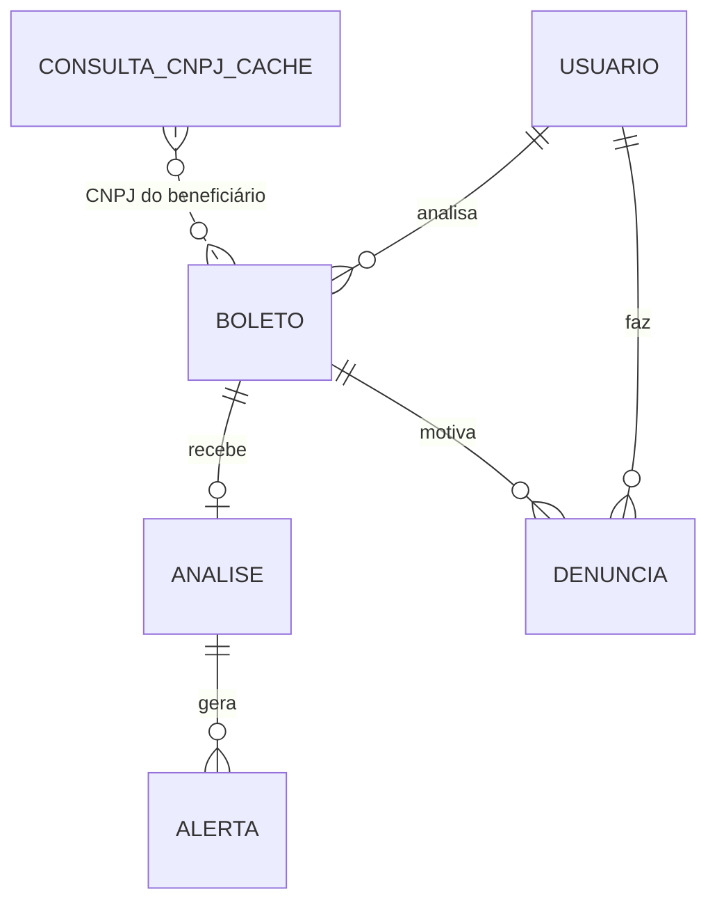
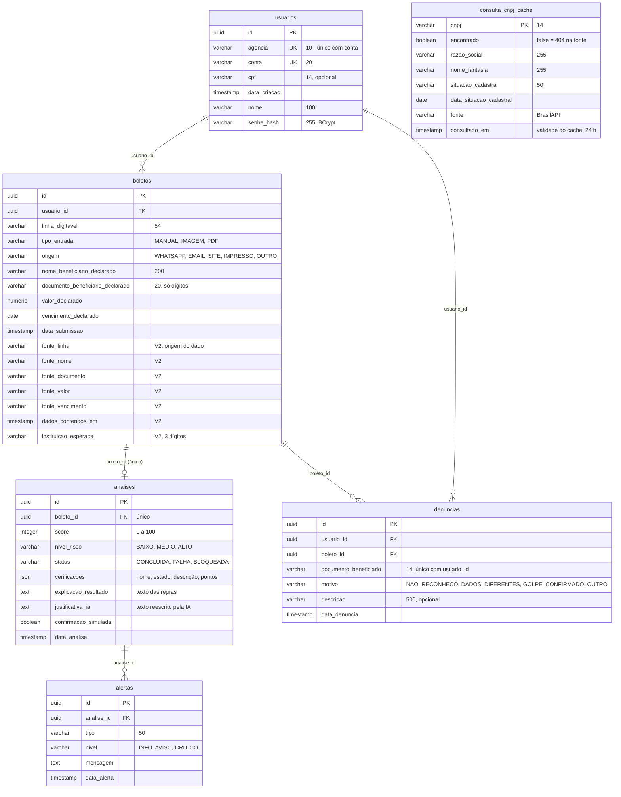

# Modelo de dados (MER / DER)

> Extraído do **PostgreSQL real** em 13/11/2026, depois das migrações Flyway V1, V2 e V3
> (`src/main/resources/db/migration`). O teste `MigracoesBancoTest` confere, a cada execução, que as tabelas criadas
> pelas migrações correspondem exatamente às entidades Java.

## Modelo entidade-relacionamento (conceitual)

| Relacionamento | Cardinalidade | Garantia no banco |
|---|---|---|
| Usuário analisa boletos | 1 : 0..N | `boletos.usuario_id` NOT NULL + FK |
| Boleto recebe análise | 1 : 0..1 | `analises.boleto_id` NOT NULL + FK + **UNIQUE** |
| Análise gera alertas | 1 : 0..N | `alertas.analise_id` NOT NULL + FK |
| Usuário faz denúncias | 1 : 0..N | `denuncias.usuario_id` NOT NULL + FK |
| Boleto motiva denúncias | 1 : 0..N | `denuncias.boleto_id` NOT NULL + FK |
| Uma denúncia por usuário e documento | — | **UNIQUE** (`usuario_id`, `documento_beneficiario`) |
| Login único | — | **UNIQUE** (`agencia`, `conta`) |
| Cache de CNPJ ↔ boleto | lógico | sem FK: liga pelo CNPJ (`boletos.documento_beneficiario_declarado` = `consulta_cnpj_cache.cnpj`); o cache é compartilhado por todos os usuários e só guarda dados públicos de empresas |

## Diagrama entidade-relacionamento (físico)

## Dicionário de dados

### `usuarios`
Usuários de demonstração (fictícios), criados pelo `DataSeeder` na primeira execução. Senha guardada só como hash BCrypt.

### `boletos`
Cada boleto submetido para análise. Guarda o que o usuário **confirmou** na tela de conferência:

| Coluna | Observação |
|---|---|
| `linha_digitavel` | Normalizada (só dígitos), 47 posições |
| `tipo_entrada` | Como o boleto chegou: digitado, imagem ou PDF |
| `fonte_*` | De onde veio cada dado: `TEXTO_PDF`, `CODIGO_BARRAS`, `OCR_LOCAL`, `IA` ou `USUARIO` (digitado ou corrigido). Nulo quando o campo ficou vazio |
| `dados_conferidos_em` | Momento em que o usuário marcou "Conferi os dados" — nenhuma leitura automática é aceita sem isso |
| `instituicao_esperada` | Código do banco que o usuário esperava (opcional), comparado com o código da linha |

O arquivo enviado (imagem/PDF) **não é guardado** em lugar nenhum.

### `analises`
Resultado do motor de risco: nota, nível, a lista de verificações (JSON) e as duas versões da explicação:
`explicacao_resultado` (gerada pelas regras, sempre presente) e `justificativa_ia` (reescrita pela IA, quando disponível).
`confirmacao_simulada` registra a decisão de "pagar" no protótipo — nenhum valor é movimentado.

### `alertas`
Mensagens de alerta da análise, uma por linha (nível `CRITICO` quando o risco é alto).

### `denuncias`
Denúncia de um usuário contra o CPF/CNPJ do beneficiário de um boleto que **ele** analisou. Outros usuários veem apenas a
**quantidade** de pessoas que denunciaram o documento (nunca quem, nem a descrição).

### `consulta_cnpj_cache`
Última resposta da consulta pública de CNPJ (BrasilAPI / Receita Federal). Evita repetir a consulta e permite mostrar o
último dado conhecido, marcado como **desatualizado**, quando a fonte está fora do ar. **CPF nunca é consultado nem gravado aqui.**

### `flyway_schema_history`
Controle interno do Flyway (versões aplicadas). Não faz parte do modelo de negócio.

## Histórico das migrações

| Versão | Arquivo | Conteúdo |
|---|---|---|
| V1 | `V1__esquema_inicial.sql` | Esquema do Checkpoint 2 (usuários, boletos, análises, alertas) |
| V2 | `V2__consulta_cnpj_e_origem_dos_dados.sql` | `consulta_cnpj_cache` e colunas de origem dos dados, conferência e instituição esperada |
| V3 | `V3__denuncias.sql` | `denuncias` (+ índice por documento) |
